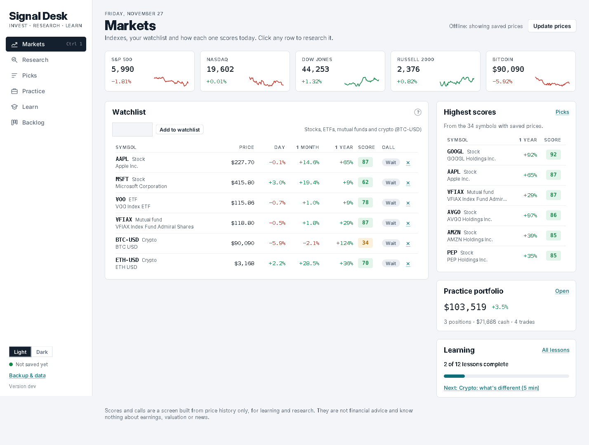
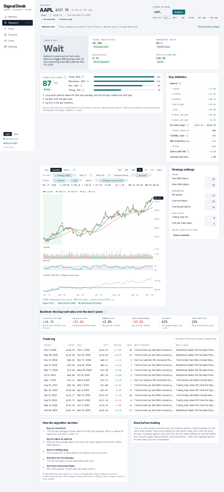
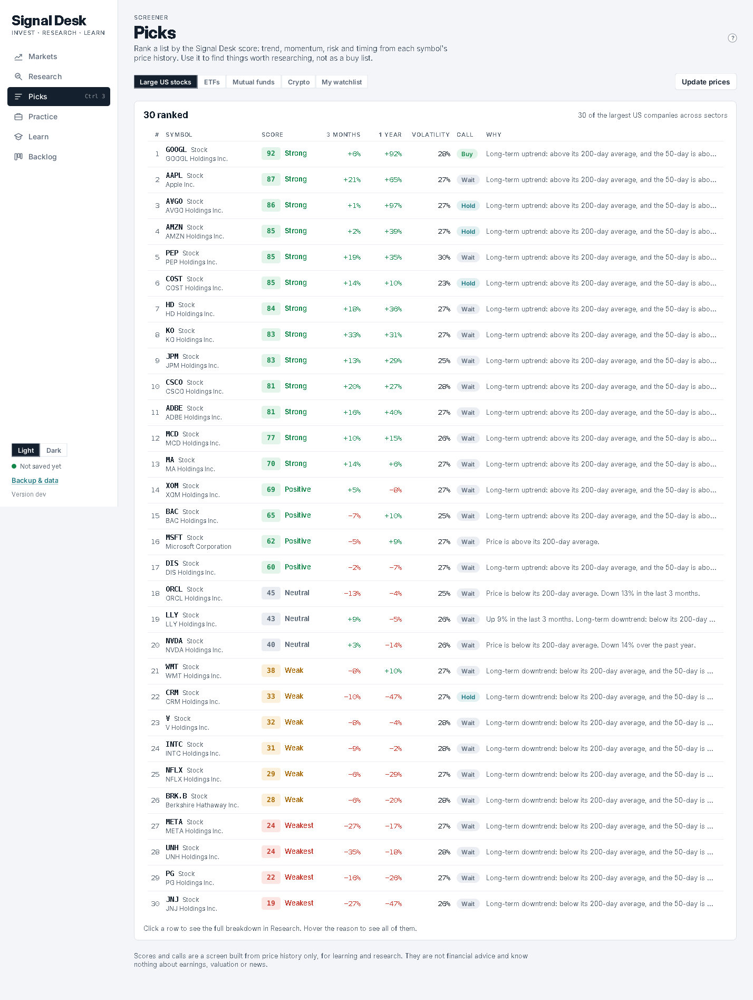
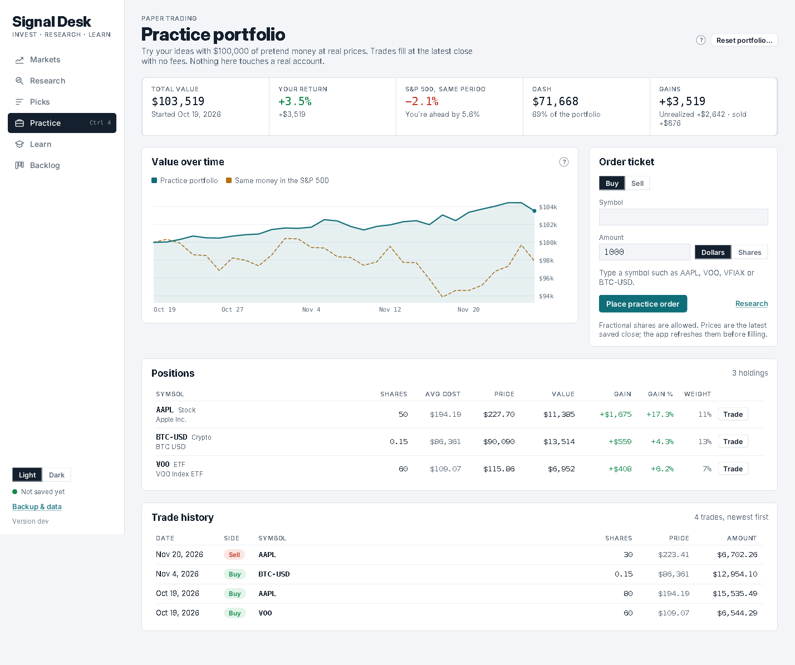
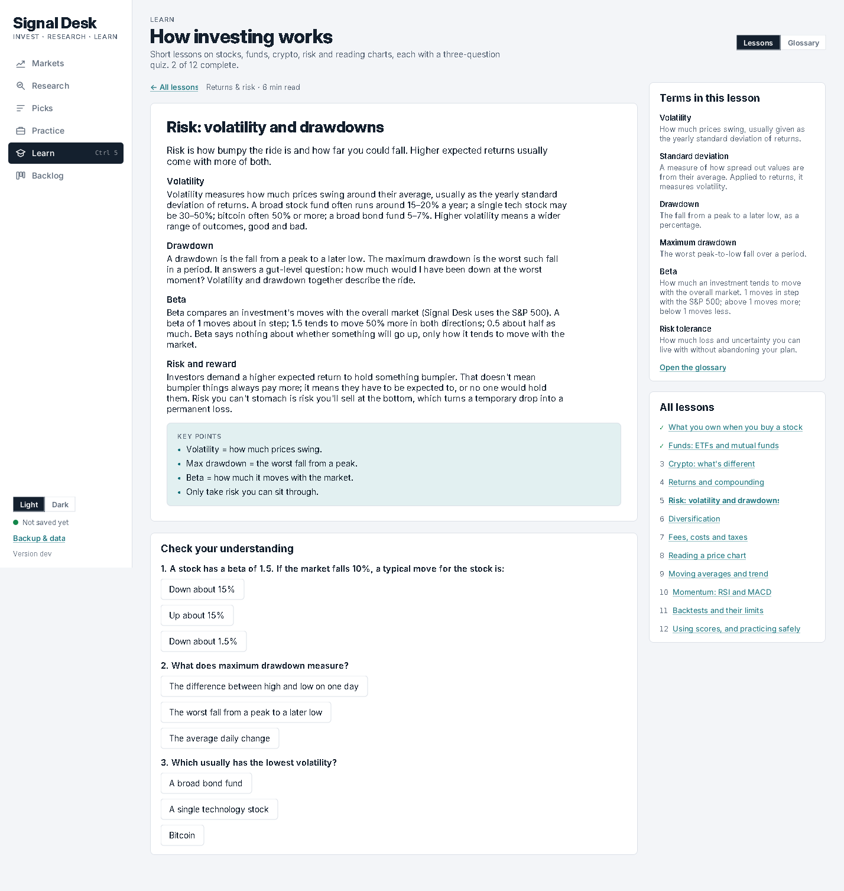

# Signal Desk

An app for learning about investing and researching stocks, ETFs, mutual funds and crypto. Pick any symbol and its full price history downloads and charts automatically. Every symbol gets a transparent 0–100 score with the reasons behind it, a screener ranks whole lists, a practice portfolio lets you trade with pretend money at real prices, and short lessons with quizzes explain everything on screen.

Version 2.0 of the desktop app is about investing and learning only. The household budget, bills, debt, net worth and retirement sections of version 1 were removed; they remain in this repository's history (version 1.1.0 and earlier).



## Sections

- **Markets** (home): S&P 500, Nasdaq, Dow, Russell 2000 and Bitcoin; your watchlist with price, day, 1-month and 1-year change, score and today's call; the highest-scoring symbols you've looked at; and your practice and learning progress.
- **Research**: line, candlestick or OHLC charts over the full daily history with SMA, EMA 21, SMA 200, Bollinger Bands, volume, RSI and MACD; the Signal Desk score with its four parts and plain-language reasons; key statistics (returns from 1 month to 5 years, 52-week range, volatility, drawdown, beta against the S&P 500, average volume); and the buy/sell rules backtested over five years against buy-and-hold.
- **Picks**: rank 30 large US stocks, 15 ETFs, 12 mutual funds, 10 cryptocurrencies or your watchlist by score, with the main reason for each.
- **Practice**: a paper-trading portfolio that starts with $100,000 of pretend money. Buy and sell in dollars or shares (fractions allowed) at the latest close, and compare your results with the S&P 500 over the same period.
- **Learn**: 12 lessons from "what you own when you buy a stock" to "backtests and their limits", each with a three-question quiz, plus a searchable glossary of 57 terms. Every statistic, score part and chart control has a **?** button that explains it and links to the glossary.
- **Backlog**: the project's own to-do board.

### How the score works
Each symbol is scored from its price history alone, so stocks, funds and crypto are judged the same way:

| Part | Weight | What it measures |
|---|---|---|
| Trend | 30% | Price against its 50- and 200-day averages, and whether the 200-day is rising |
| Momentum | 30% | 12-month return (60%) and 3-month return (40%) |
| Risk | 25% | Yearly volatility (60%) and the worst drop in the past year (40%); calmer scores higher |
| Timing | 15% | The buy/sell rules' current call; overbought RSI subtracts |

70 and up is Strong, 55–69 Positive, 40–54 Neutral, 25–39 Weak, below 25 Weakest. The score is a screen for research. It knows nothing about earnings, valuation or news, and it is not advice.



| Picks | Practice | Learn |
|---|---|---|
|  |  |  |

## Desktop app

### Run
Double-click `SignalDesk-2.0.0.jar` (the number is the version), or:

```sh
java -jar SignalDesk-2.0.0.jar
```

Requires Java 17 or newer. There are no other dependencies. Opening a version 1 data file keeps a copy as `backups/studio-v1-<date>.json` and turns its investment symbols into your watchlist.

### Build
```sh
cd desktop
./build.sh        # produces desktop/SignalDesk-<version>.jar
```
The version lives in `desktop/VERSION`. Change it there and rebuild; the jar's name, its manifest and the version shown in the app all follow. Lesson, glossary and explanation text lives in `desktop/tools/learn_content.py`; run it to regenerate `desktop/res/content/learn.json`.

### Code layout
```
desktop/src/com/signaldesk/
  App.java          entry point: loads studio.json (or starts fresh) and opens the window
  json/             dependency-free JSON reader and writer
  model/            watchlist, practice portfolio, lesson progress, strategy settings, backlog
  signals/          price series, indicators, buy/sell engine, key statistics, the score, asset types
  store/            file storage, daily backups, saved prices, Yahoo Finance downloads and search, screener lists
  learn/            loads lessons, quizzes, glossary and explanations
  ui/               Swing window, theme (light and dark), widgets, charts, background price service
  ui/views/         one class per section
desktop/res/        bundled fonts (licenses included) and learning content
desktop/test/       Roundtrip (save, reload, version 1 migration), Shots (renders each section),
                    AutoPrices + mock/yahoo_mock.py (end-to-end downloads against a local stand-in server),
                    HistoryTest (full download, saved file, incremental merge, re-download after a dividend),
                    ChartShots (renders the chart types)
```

### Prices
Type a ticker (MSFT, VOO, VFIAX, BTC-USD) or a name (Microsoft, Bitcoin) on the Research page and pick a match. The symbol's entire daily history (open, high, low, close, adjusted close and volume) downloads from Yahoo Finance's public chart service and is saved as `SignalDesk/prices/<SYMBOL>.csv` in the standard `Date,Open,High,Low,Close,Adj Close,Volume` layout, which opens in Excel. After the first download only the last month is fetched and merged in. If those days no longer match what's saved (a split or dividend changed past adjusted prices), the full history is downloaded again. While Research is open prices refresh every 5 minutes; the indexes, your watchlist and practice positions update when the app opens. Crypto trades every day, so its returns and volatility are annualized over 365 days rather than about 252. No account or API key is needed. If the service can't be reached, the last saved prices are shown. Yahoo's service is free but unofficial, so it can change without notice.

Charts show adjusted prices, so candles, the close line and every indicator stay on one consistent scale across splits and dividends. Chart type, range and indicators are remembered in `SignalDesk/settings.json`.

## Web version (legacy)
`web/index.html` is the version 1 finance studio published as a claude.ai artifact. It still has the household budget sections and hasn't been updated for 2.0; bringing it in line is on the backlog.

## Not financial advice
Signal Desk is an education and screening tool. Scores rank past price behavior, backtests describe the past, and nothing here is a recommendation to buy or sell. Consider your own goals, and a qualified professional, before investing real money.
