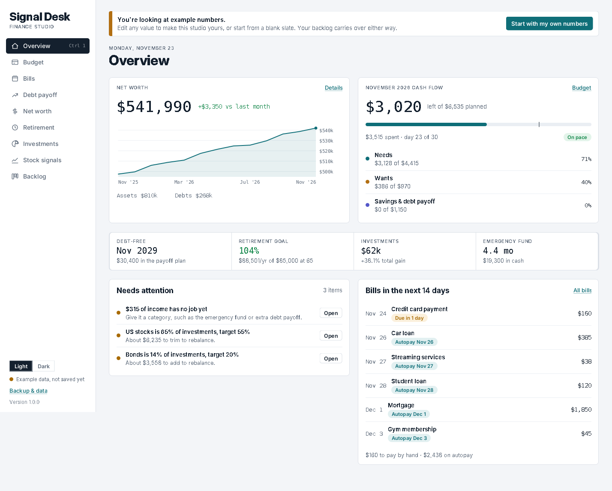
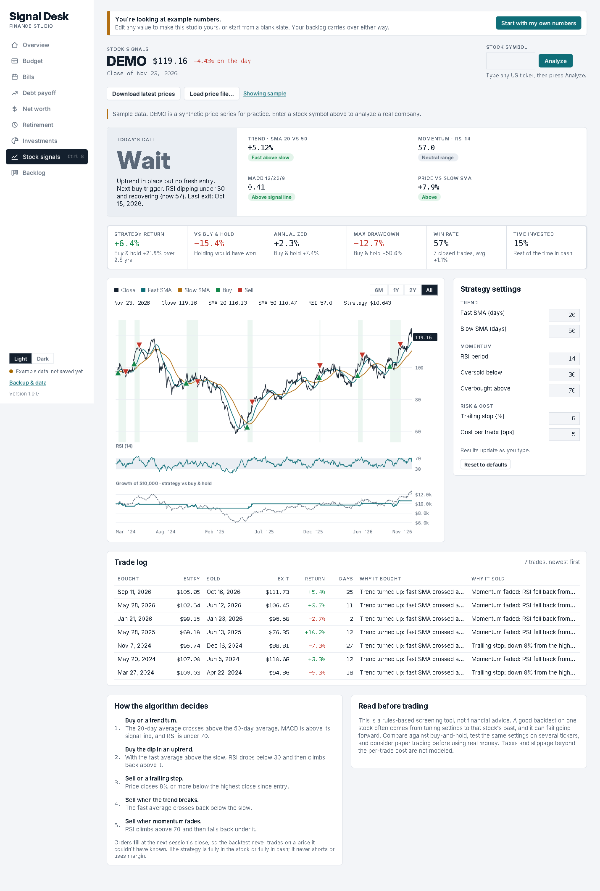

# Signal Desk

A personal finance studio: budget, bills, debt payoff, net worth, retirement planning, investments, stock buy/sell signals, and a project backlog, in one place.

It comes in two versions that share the same calculations and data format:

| | Desktop app (`desktop/`) | Web page (`web/`) |
|---|---|---|
| Runs as | `SignalDesk.jar`, Java 17+ | One HTML page, published as a claude.ai artifact |
| Your data | `SignalDesk/studio.json` in your home folder, saved automatically, with daily backups | Your claude.ai account |
| Stock prices | Downloads daily prices from Stooq | Load a price file you download |



## Sections

- **Overview**: net worth trend, this month's cash flow, what needs attention, and bills due in the next two weeks.
- **Budget**: monthly income and categories grouped into needs, wants and savings, checked against the 50/30/20 guide, plus an expense log.
- **Bills**: recurring monthly, quarterly and yearly bills on a calendar. Paid bills flow into the budget.
- **Debt payoff**: avalanche or snowball plan with minimum roll-over, debt-free date, and total interest compared with paying minimums only.
- **Net worth**: accounts and assets against debts, with a monthly history.
- **Retirement**: year-by-year projection in today's dollars across traditional, Roth and taxable savings, with employer match, Social Security, 2026 IRS 401(k) limits, and a drawdown to your plan-to age.
- **Investments**: holdings, gains, and allocation against targets with rebalancing amounts.
- **Stock signals**: a rules-based trend and momentum model (SMA crossovers confirmed by MACD, RSI dip-buys, trailing stop) with a backtest against buy-and-hold.
- **Backlog**: the project's own to-do board.



## Desktop app

### Run
Double-click `SignalDesk.jar`, or:

```sh
java -jar SignalDesk.jar
```

Requires Java 17 or newer. There are no other dependencies.

### Build
```sh
cd desktop
./build.sh        # produces desktop/SignalDesk.jar
```

### Code layout
```
desktop/src/com/signaldesk/
  App.java          entry point: loads studio.json (or the example household) and opens the window
  json/             dependency-free JSON reader and writer
  model/            data model; JSON shape matches the web version's backup format
  calc/             budget, bills, debt, net worth, portfolio, retirement and attention-list engines
  signals/          price-file parsing and the buy/sell signal engine
  store/            file storage, daily backups, price files, Stooq downloads, example data
  ui/               Swing window, theme (light and dark), widgets, editable tables, charts
  ui/views/         one class per section
desktop/res/fonts/  Inter and DejaVu Sans Mono, bundled so the app looks the same everywhere (licenses included)
desktop/test/       Parity (checks numbers), Roundtrip (save and reload), Shots (renders each section to PNG)
```

### Moving data between versions
In the web version, use **Backup & data → Export backup**. In the desktop app, use **Backup & data → Restore from backup** and pick that file. The two versions do not sync automatically.

## Web version
`web/index.html` is the published page. It runs inside claude.ai, where it saves to your account.

## Not financial advice
Signal Desk is a planning and screening tool. Backtests describe the past, projections assume steady returns, and nothing here is a recommendation to buy or sell.
